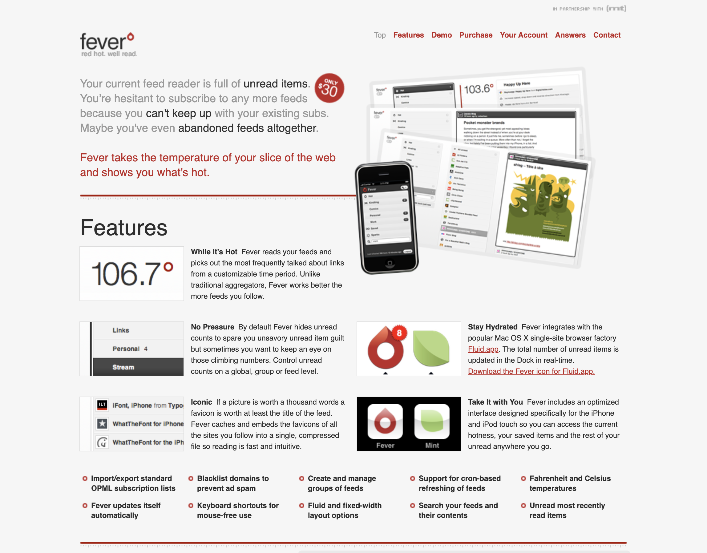
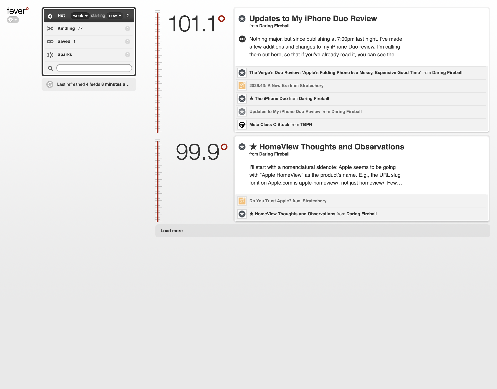
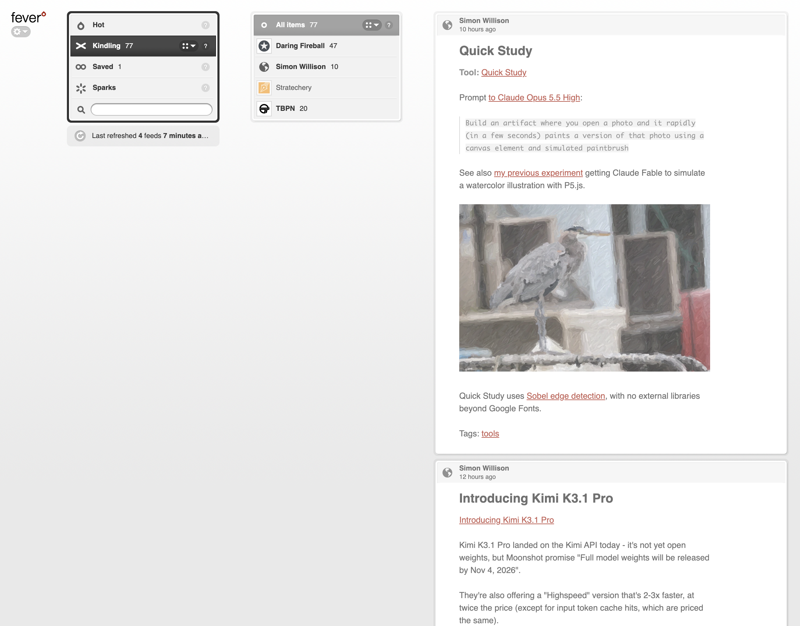
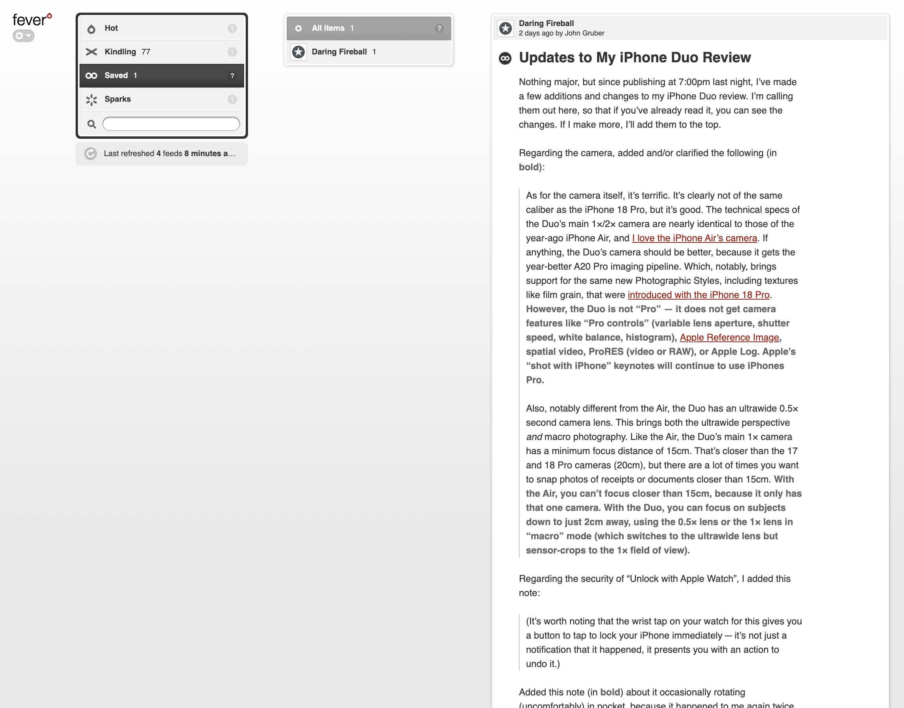

# Fever



Shaun Inman released [Fever](https://chrishubbs.com/2009/06/17/a-first-look-at-shaun/) in 2009 as a feed reader you installed on your own PHP and MySQL server. It counted what the writers you follow linked to, and when several of your feeds pointed at the same page, that page rose to the top. Inman [retired Fever in 2016](https://web.archive.org/web/20161226201905/http://www.shauninman.com/archive/2016/12/24/goodbye_mint_goodbye_fever).

This independent project is Fever's rebirth on Next.js, React, TypeScript, Drizzle and PostgreSQL. It keeps the original interface, artwork, ranking and behavior, so it looks and works like Fever 1.x. Fever's design and original artwork are Shaun Inman's work.

## Features

Fever is a private reader for one person. You choose the writers to follow, and Hot shows you the pages several of them are linking to. Kindling is your main reading list, and Saved keeps whatever you want to come back to.

- Hot ranks pages by how many of your feeds link to them within a period you choose, such as the past week.
- Sparks are feeds you subscribe to only for their links. They raise temperatures in Hot without adding items to Kindling.
- Groups collect related feeds so you can read or mark them read together.
- Keyboard shortcuts: `1` to `4` switch sections, `J` and `K` move between items, `S` saves, `A` marks the current group or feed read and `Z` undoes it. `?` or `/shortcuts` lists every shortcut.
- A compact reader for phones has its own layout.
- OPML import and export move subscriptions in and out.
- A Fever API endpoint works with existing apps that sync with Fever servers.
- Feedlet, the subscribe bookmarklet, a link blacklist for Hot and opt-in [custom stylesheets](docs/CUSTOM_STYLES.md) carry over from the original.



Hot ranks pages that several of your feeds, including Sparks, link to at the same normalized URL, with a temperature that rises with each linking feed. Each entry lists the items that linked to it, so you can see who is talking about it.



Kindling is the main reading list, holding items from every feed you subscribe to except Sparks. Choose a group in the left column, or a feed in the middle column with its unread count, to narrow the list.



Saved keeps items you mark for later, whether or not you have read them. You can save from Kindling or Hot, and the feed column filters the saved list by source.

## Setup

You need Node.js 24.22.1, pnpm 11.25.0 and PostgreSQL 18. Use a direct or session-pooling database connection, because the schema tool takes a session advisory lock that transaction poolers such as Neon's `-pooler` endpoints do not hold.

1. Clone and install:

   ```sh
   git clone https://github.com/0xSMW/fever-next
   cd fever-next
   pnpm install --frozen-lockfile
   ```

2. Create an empty PostgreSQL database.

3. Create the environment file. The operator CLI refuses an env file that other users can read, so restrict it:

   ```sh
   cp .env.example .env.local
   chmod 600 .env.local
   ```

   Edit these values in `.env.local`:

   - `DATABASE_URL` is your PostgreSQL URL. Leave `sslmode` and other TLS parameters out of it.
   - `FEVER_DB_SSL=false` suits a local database. Set `true` for hosted PostgreSQL, which turns on verified TLS.
   - `FEVER_BASE_URL=http://localhost:3000` and `NEXTAUTH_URL=http://localhost:3000/api/auth`. `NEXTAUTH_URL` must be the base URL plus `/api/auth`. Leave `NEXT_PUBLIC_BASE_PATH` empty unless Fever runs under a path.
   - `NEXTAUTH_SECRET`, `FEVER_SETUP_TOKEN` and `FEVER_ENCRYPTION_KEY` each need their own value. Run `openssl rand -base64 32` three times and assign one output to each. Back up `FEVER_ENCRYPTION_KEY` with your database backups, because encrypted feed credentials cannot be read without it.

4. Apply the schema. Inspect the target first; this prints a JSON identity with a 64-character `fingerprint`:

   ```sh
   pnpm ops inspect-target --env-file "$PWD/.env.local" --target-url-env DATABASE_URL
   ```

   Replace `PASTE_FINGERPRINT_HERE` with that fingerprint and run the migration, which requires a matching confirmation:

   ```sh
   FP='PASTE_FINGERPRINT_HERE'
   pnpm db:migrate apply --env-file "$PWD/.env.local" --target-url-env DATABASE_URL \
     --target-fingerprint "$FP" --confirm "migrate:$FP"
   ```

5. Start the web app with `pnpm dev`. Next.js loads `.env.local` itself.

6. Open http://localhost:3000/setup and enter the setup token, the owner email and password, and a temperature unit. You can remove `FEVER_SETUP_TOKEN` afterward.

7. Start the refresh worker in a second terminal:

   ```sh
   node --env-file=.env.local --conditions=react-server --import tsx worker/index.ts
   ```

For production, run `pnpm build && pnpm start` behind an HTTPS proxy and supervise the worker as a separate long-running process. Set `FEVER_BASE_URL` to the public HTTPS URL and `NEXTAUTH_URL` to that URL plus `/api/auth`. If Fever runs under a path, set `NEXT_PUBLIC_BASE_PATH` to it before building, because the path is compiled into the build.

Vercel with Neon also works. Configure the same environment variables and secrets as `.env.local`, apply the schema from your machine with the commands above, and for Git deployments use the repository root as the project's Root Directory. Then set `FEVER_BASE_URL` and `NEXTAUTH_URL` to the public HTTPS URLs, add `CRON_SECRET`, and use a direct (non-pooler) Neon URL with `FEVER_DB_SSL=true` and `FEVER_DB_POOL_MAX` of 2 or more. The included `vercel.json` already calls the authenticated `/api/internal/refresh` endpoint every minute with `CRON_SECRET`, so no worker daemon runs on Vercel.

The [operations guide](docs/OPERATIONS.md) covers backups, restores, key export, owner recovery and monitoring. The [migration runbook](docs/MIGRATION_RUNBOOK.md) covers importing an existing Fever 1.x installation.

For development checks and optional integration suites, see [testing](tests/README.md).
